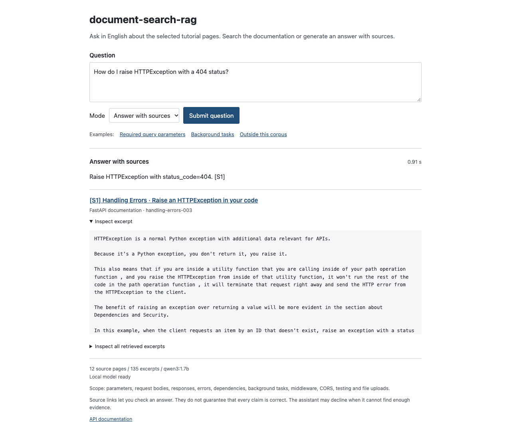
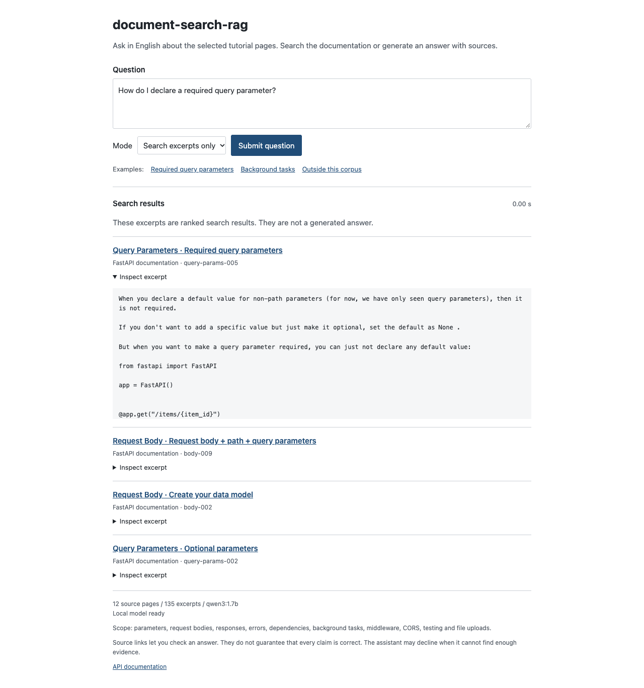
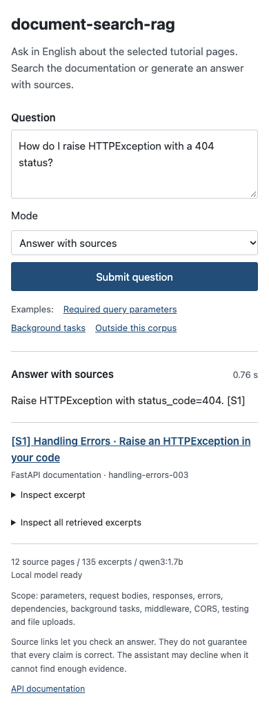

[English](README.md) | [Italiano](README.it.md)

# document-search-rag

The public name is `document-search-rag`. The folder and Python package are named `doclens`, as shown in the commands below.

A local assistant for FastAPI documentation: ask a question, retrieve relevant excerpts, get a model response, and inspect its sources. When the evidence appears insufficient, the assistant can decline to answer. A separate search mode lets you inspect the retrieved text without generation and compare it with the RAG response.

document-search-rag uses Ollama and `qwen3:1.7b`. It needs no OpenAI API key or paid service. Search works even when Ollama is unavailable.

## See it in action

Question: `How do I raise HTTPException with a 404 status?`

An actual response from the application:

> Raise HTTPException with status_code=404. [S1]

The `[S1]` citation links to [Raise an HTTPException in your code](https://fastapi.tiangolo.com/tutorial/handling-errors/#raise-an-httpexception-in-your-code). Open the excerpt in the interface to compare the answer with the documentation.



Search mode returns excerpts without generating an answer. This example searches for how to declare a required query parameter.



<details>
<summary>Mobile view: answer and sources</summary>



</details>

These screenshots show the running local application with a plain interface: a question field, controls, a result and a list of sources. They contain only the application page, with no browser toolbar, other windows or cursor. See the initial state in [ui-desktop.png](reports/ui-desktop.png).

## Measured results

Corpus: 12 official FastAPI pages, split into 135 excerpts. The table shows saved runs with `qwen3:1.7b` on an Apple M3 with 16 GB RAM. The main set was used during development. The fresh 12-question set was run after the thresholds were frozen, with no further tuning.

| Check | Main set: 60 questions | Fresh set: 12 questions |
|---|---:|---:|
| Expected page among the top four search results | 45/45 answerable | 6/6 answerable |
| Abstention on questions outside the corpus | 15/15 | 6/6 |
| Unnecessary abstention on answerable questions | 3/45 | 2/6 |
| Expected keywords present in the answer | 41/45 (91.11%) | 3/6 (50%) |
| Citations pointing to the expected page, among citations emitted | 42/42 (100%) | 3/4 (75%) |
| Latency of emitted answers, p50 / p95 | 2.43 / 3.36 s | 2.21 / 2.68 s |
| Technical errors | 0/60 | 0/12 |

**Passing a check does not establish factual accuracy.** Keyword matching is only a proxy. A source spot check found an invented `item:` requirement in q10 and incorrect background-task timing in q28, despite technically valid citation IDs. On the fresh set, the coverage guard rejected two answerable paraphrases, and one answer cited an unsuitable excerpt. Every question has the draft label `draft_unreviewed`; the full set has not received an independent human review.

Methodology and failure cases: [quality report](reports/QUALITY.md). Raw results: [main run](reports/evaluation.json), [fresh set](reports/fresh-probe.json), [source spot checks](reports/source-spot-checks.json). Interface checks: [ui-checks.json](reports/ui-checks.json).

## Run locally

Tested environment: macOS, Apple M3, 16 GB RAM, Python 3.10. The installed `qwen3:1.7b` model uses about 1.4 GB of disk space. The application does not download models automatically.

```bash
cd /path/to/doclens
python3 -m venv .venv
.venv/bin/python -m pip install --upgrade pip
.venv/bin/python -m pip install -r requirements.lock
.venv/bin/python -m pip install -e . --no-deps
ollama list
.venv/bin/python -m uvicorn doclens.app:app --host 127.0.0.1 --port 8013
```

Open <http://127.0.0.1:8013>. The API documentation is at <http://127.0.0.1:8013/docs>. Ollama must be running at `127.0.0.1:11434`, with `qwen3:1.7b` listed by `ollama list`. If the model is unavailable, the interface reports it and offers excerpt search. Press Ctrl+C to stop the server.

The questions and corpus are in English. Examples:

- `How do I raise HTTPException with a 404 status?`
- `How do I declare a required query parameter?`
- `When do background tasks run?`
- `How do I configure Kubernetes autoscaling for a FastAPI deployment?` - expected abstention: this topic is outside the corpus.

This is a local demo for one user. It has no authentication, request queue or load limits for a public service. The application does not save question history; the evaluation script writes the questions and answers from its fixed dataset to a report.

## Project structure

```text
doclens/
  app.py             HTTP API and static files
  config.py          paths, model and local Ollama address
  retrieval.py       tokenization, BM25 and ranking
  rag.py             model requests, abstention and citation ID validation
  static/            HTML, CSS and JavaScript without a frontend build
scripts/
  build_corpus.py    download and reproducible HTML processing
  evaluate.py        search and RAG on the same question set
  ui_smoke.py        interface checks in a separate headless Chrome profile
data/
  raw/               snapshots of official pages
  manifest.json      URLs, download times and each file's SHA-256
  chunks.json        excerpts with headings and section links
eval/questions.json  45 answerable and 15 unanswerable questions
tests/               retrieval, abstention, API, corpus and error tests
reports/             actual responses, metrics, screenshots and limitations
```

There is no LangChain, vector database or separate frontend framework. The corpus is small, and plain Python makes each step easy to follow.

1. `build_corpus.py` extracts the article, removes navigation, preserves code and splits text by heading. Large sections become chunks of roughly 2,400 characters with a small overlap. Each source link points to the corresponding section of the original page.
2. BM25 ranks chunks using the question's words. Page titles and section headings are included in the index. Lexical search handles synonyms and other languages less well than an embedding model; a question in another language may miss the English material.
3. The top four chunks go to the model. Very weak matches are rejected before generation. At least 60% of the question's meaningful words must also appear in the retrieved chunks. `min_score=2.0` and `min_coverage=0.6` are heuristics, not confidence probabilities or proof that an answer exists. The coverage guard was added after failures on the development set. It is conservative and can reject paraphrases or synonyms.
4. The model returns JSON containing an answer, an answerability decision and references `[S1]` to `[S4]`. A simple JSON schema is compatible with the installed backend; Python checks length constraints.
5. Pydantic validates the structure. Unknown or undeclared references are rejected. Extra declared IDs from the retrieved chunks are not displayed unless the answer mentions them. URLs come from the corpus, not the model's text. An abstention has status `abstained`; an Ollama failure returns HTTP 503 and is recorded as a technical error.

ID validation prevents invented source addresses, but does not prove that a source supports every claim. The small model can make mistakes or decline an answer that is present. The interface therefore exposes source excerpts, while evaluation measures citations, abstentions and answer content separately.

## Corpus

Twelve pages from the [official FastAPI tutorial](https://fastapi.tiangolo.com/tutorial/): path parameters, query parameters, request body, response model, response status code, handling errors, dependencies, background tasks, middleware, CORS, testing and request files. The saved snapshot produces 135 chunks.

Normal startup does not contact the website. Rebuilding from the saved HTML verifies SHA-256 hashes and should produce the same JSON:

```bash
.venv/bin/python scripts/build_corpus.py
```

An explicit refresh requires network access and changes the data and evaluation results:

```bash
.venv/bin/python scripts/build_corpus.py --refresh
```

The original materials belong to the FastAPI authors. License information is in the [FastAPI repository](https://github.com/fastapi/fastapi/blob/master/LICENSE). Source URLs and snapshot times are stored in `data/manifest.json`.

## Checks and evaluation

```bash
.venv/bin/ruff check doclens scripts eval tests
.venv/bin/ruff format --check doclens scripts eval tests
.venv/bin/mypy doclens scripts eval tests
.venv/bin/python -m pytest -m 'not live' -q
.venv/bin/python -m pytest -m live -q
.venv/bin/python scripts/evaluate.py --output reports/search-baseline
.venv/bin/python scripts/evaluate.py --live --output reports/evaluation
.venv/bin/python scripts/evaluate.py --live --dataset eval/fresh-probe.json --output reports/fresh-probe
```

Without `--live`, evaluation does not call the model. With `--live`, every question passes through the real local Ollama instance and its result is written to JSONL immediately. Errors are recorded separately from abstentions. A run can take several minutes. Reusing the same `--output` replaces the report; choose a new name to compare runs.

Metric definitions, actual results and failure cases are in [reports/QUALITY.md](reports/QUALITY.md). The main distinctions:

- `gold_page_hit_at_4` checks whether the expected page appears among the four retrieved chunks. This does not establish answer correctness.
- `answer_keyword_pass_on_answerable` checks for expected words in the answer. It is a content proxy, not semantic accuracy.
- `citation_page_precision` compares cited pages with the labels. It does not check support for individual claims.
- `abstention_recall` measures abstention on questions outside the corpus; `false_abstention_on_answerable` measures unnecessary refusals.
- p50 is the median; p95 uses the nearest rank, `ceil(0.95 * n)`. Both describe one sequential run on the stated machine.

All 60 questions have `review_status: draft_unreviewed`. Neither all labels nor all answers have received an independent human review. This corpus-specific set is a development check, not an independent benchmark. Successful keyword checks must not be presented as "100% RAG accuracy".

The separate `eval/fresh-probe.json` contains 12 new questions: six answerable paraphrases and six outside the corpus. It was created after freezing the thresholds, separately from dev60, and was not used for further tuning. It is a small additional experiment without an independent reviewer; results are in `reports/fresh-probe.*`.

To check the interface, start the server, then run:

```bash
.venv/bin/python scripts/ui_smoke.py
```

The script uses installed Chrome with a fresh temporary profile to check search, a real generated answer, abstention, source inspection, mobile width and a simulated HTTP 503. Use `--chrome` for a different browser executable path. Personal tabs are not used.

## Configuration

Optional variables: `DOCLENS_MODEL`, `DOCLENS_OLLAMA_URL`, `DOCLENS_CORPUS`. The defaults require no configuration. Ollama's address is restricted to loopback HTTP so questions are not sent to a remote server. `DOCLENS_MODEL` selects an already installed model; the code does not download it.

## Next steps

First, independently review the labels and whether sources support the answers' claims. Then add a separate set of paraphrases and questions with partially available answers. After that, compare BM25 with embedding retrieval or another local model to identify which failures come from retrieval and which come from generation.
